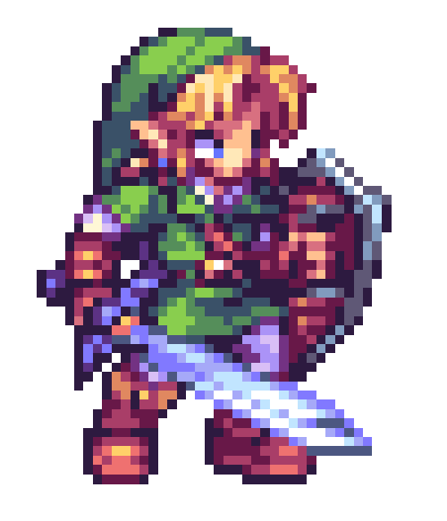

# <samp>Thiago Fabri</samp> 

## <samp>Hello World!</samp> 

<samp>Olá! Eu sou o Thiago, estudante de Análise e Desenvolvimento de Sistemas e estagiário de TI em uma consultoria de negócios, onde trabalho com **dados, dashboards e automações**.</samp>

<samp>Meu foco é transformar dados brutos em informação útil para decisão: coletar, tratar, organizar em banco de dados e apresentar de forma clara. Minha base em back-end (APIs e bancos) é o que sustenta isso.</samp>

- 📊&nbsp;<samp>Foco em dados: tratamento, SQL, relatórios e dashboards</samp>
- ⚙️&nbsp;<samp>Automação de processos com APIs e webhooks</samp>
- 👨‍🎓&nbsp;<samp>Estudante de Análise e Desenvolvimento de Sistemas</samp>
- 🎓&nbsp;<samp>Minha vida acadêmica e certificados: [__aqui!__](https://github.com/TllFabri/course-certificate)</samp>

---

### <samp>🧰 Ferramentas</samp>

<samp>**Dados**</samp> 

<samp>**Automação e organização**</samp> 

<samp>**Desenvolvimento**</samp> 

